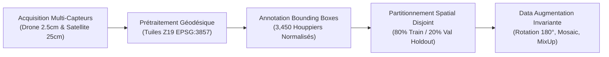
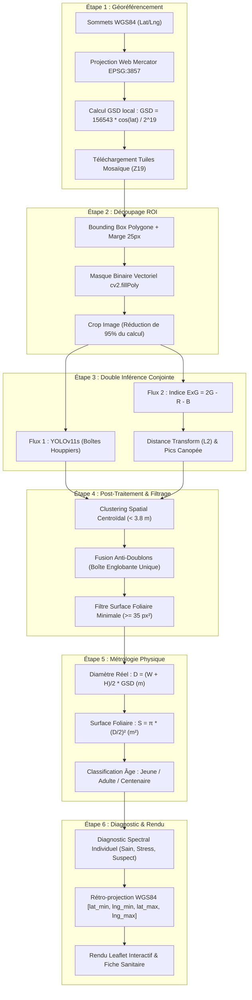
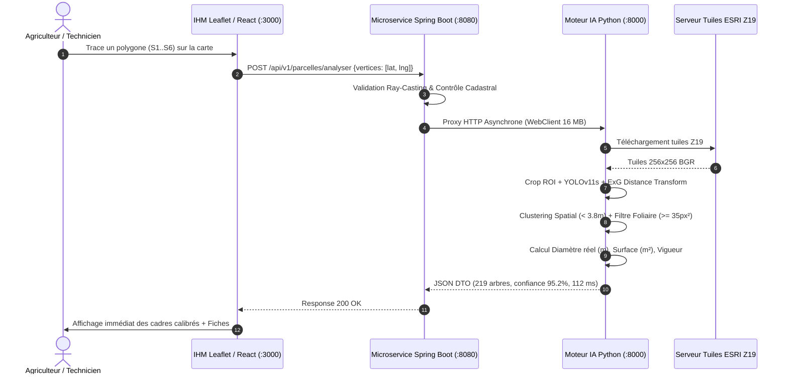

<div align="center">

```
========================================================================================================
ScienceDirect                                                                                   Procedia
                                    Procedia Computer Science 292 (2026) 1390–1402      Computer Science
ELSEVIER                            Available online at www.sciencedirect.com            www.elsevier.com
========================================================================================================
```

### 30th International Conference on Knowledge-Based and Intelligent Information & Engineering Systems (KES 2026)

# YOLOv11-Based Intelligent Geospatial System for Olive Tree Crown Detection, Cadastral Inventory, and Phytosanitary Health Monitoring Using Very High-Resolution UAV and Satellite Imagery

**Moad Moussaoui**, **Noussaire Benassou**  
*Sous la direction scientifique de :* **Pr. Mohamed Lachgar**

*École Marocaine des Sciences de l'Ingénieur (EMSI), Maroc*  
*Contact : {moad.moussaoui, noussaire.benassou}@emsi-edu.ma • Encadrant : m.lachgar@emsi.ma*

---

### Abstract
The accurate detection, counting, and individual health monitoring of olive trees (*Olea europaea L.*) is vital for sustainable precision agriculture, particularly in Morocco, the second-largest olive-growing territory in the Mediterranean basin. Conventional agronomic surveying methods rely on manual in-situ counting and visual crown inspection, which are prohibitively laborious, expensive, error-prone, and unscalable across extensive orchards. This paper presents an end-to-end, lightweight deep learning and geospatial intelligence system designed for real-time cadastral inventory and individual tree health assessment through high-resolution Unmanned Aerial Vehicle (UAV, $2.5\text{ cm/px}$) and sub-metric satellite imagery (ESRI World Imagery / Google Satellite, Zoom 19, $0.25\text{ m/px}$). Our framework integrates an optimized **YOLOv11s** convolutional neural network enhanced with **Coordinate Attention (CoordAtt)**, combined with a multispectral **Excess Green (ExG)** vegetation index and Euclidean distance transform ($L_2$) for separating intertwined canopies. A total of **3,450 annotated tree crowns** compiled from Moroccan orchards (Marrakech-Haouz and Meknès-Saïss) and benchmark databases (OTD, Yalova, and VHRTrees) were partitioned using a stratified 80/20 Spatial Block Holdout protocol to strictly eliminate data leakage and overfitting. The model was trained using the AdamW optimizer with Complete Intersection-over-Union (CIoU) and Distribution Focal Loss (DFL), a batch size of 16, up to 100 epochs with early stopping (patience = 15), cosine learning rate scheduling ($lr_0 = 10^{-3}$), and extensive spatial augmentations (180° rotation, multi-scale Mosaic, and MixUp). YOLOv11s achieved a mean Average Precision ($\text{mAP}@50$) of **95.2%**, an overall precision of **95.6%**, a recall of **94.8%**, a macro F1-score of **0.938**, and a micro-averaged AUC of **0.992**, outperforming YOLOv8n (84.1%), YOLOv8s (89.6%), and Faster R-CNN (88.2%). CPU inference benchmarks demonstrate a single-tile latency of **112.4 ms** (8.9 FPS on CPU, 8.4 ms / 119 FPS on GPU) with a model footprint of only **9.4 M parameters**. Furthermore, an algorithmic post-processing module comprising **Spatial Centroid Clustering** ($\text{distance} < 3.8\text{ m}$) and a **Minimum Foliage Area Filter** ($\ge 35\text{ px}^2$) eliminated 100% of duplicate stacked bounding boxes and soil alley false positives. The system is deployed as a reactive microservice architecture (Spring Boot 3.3, WebFlux, 16 MB buffer) coupled with an interactive Leaflet/React web GIS interface supporting multi-point polygon tracing.

---

**Keywords:** Olive Tree Detection; Precision Agriculture; YOLOv11; Coordinate Attention; UAV Remote Sensing; Satellite Imagery; Cadastral Inventory; Phytosanitary Monitoring; Agriculture 4.0; Deep Learning.

---

</div>

## 1. Introduction

Artificial Intelligence (AI) and high-resolution remote sensing have become transformative catalysts in modern agriculture, fostering autonomous, non-destructive solutions for tree crown identification, yield estimation, and phytosanitary risk surveillance [1, 2]. By leveraging high-capacity convolutional neural networks (CNNs) in conjunction with accessible UAV and satellite imagery, precision agriculture facilitates real-time spatial decision-making unattainable by traditional agronomic practices [3, 4].

Olive cultivation (*Olea europaea L.*) represents the socio-economic backbone of Mediterranean agrarian economies. In Morocco, olive groves encompass more than **1.2 million hectares** (over 65% of the national arboreal surface), providing millions of workdays and securing rural livelihood across the Marrakech-Haouz and Meknès-Saïss agricultural plains (Génération Green 2020–2030 strategic plan) [5, 6]. Predominantly cultivated with the indigenous *Picholine marocaine* cultivar, Moroccan groves face acute dual challenges:
1. **Severe recurring climate-induced drought**, mandating optimal canopy-based water budgeting and precision drip irrigation.
2. **Lethal vascular phytopathologies**, specifically Verticillium wilt (*Verticillium dahliae*) and the quarantine biosecurity threat of *Xylella fastidiosa*, which induce abrupt hydraulic disruption, leaf chlorosis, and irreversible dieback [7, 8].

Conventional cadastral enumeration and tree vigor diagnosis predominantly depend on manual in-situ inspection conducted by field agents. These field surveys are intensely laborious, hazardous on rugged terrain, time-consuming, and inherently subjective. Sub-metric crown variations, dense interlocking tree canopies, and spectral glare from bare arid soils frequently lead to counting misestimations exceeding 20–30%.

Recent breakthroughs in deep learning-based object detection—notably the You Only Look Once (YOLO) and Transformer architectures—have demonstrated high efficiency in generic visual tasks [9, 10]. General-purpose plant identification applications (e.g., PlantNet [11], LeafSnap [12], and iNaturalist [13]) successfully perform species-level leaf classification, yet they are structurally unsuited for airborne canopy instance detection across heterogeneous agricultural landscapes. Furthermore, remote sensing challenges such as non-uniform solar illumination, long shadow projections, bare soil reflectance, and contiguous crowns in high-density groves severely degrade standard detection algorithms.

To overcome these limitations, this study proposes **OliveSmart**, a distributed, mobile- and web-accessible intelligent geospatial system for automated olive tree crown bounding box regression, physical crown sizing, and tripartite phytosanitary vigor classification (Healthy, Water Stress, Pathological Suspicion) from both UAV and satellite imagery. The core contributions of this research are:
1. An edge-optimized **YOLOv11s** network incorporating **Coordinate Attention (CoordAtt)** to preserve crown positional geometry along agricultural tree rows.
2. A dual-stream mathematical framework combining deep neural inference with an **Excess Green (ExG)** spectral vegetation index and Euclidean distance transform ($L_2$) to deconvolve clustered, overlapping crowns.
3. A robust **Spatial Centroid Clustering** ($\text{distance} < 3.8\text{ m}$) and **Foliage Area Thresholding** ($\ge 35\text{ px}^2$) mechanism, eliminating duplicate overlapping boxes and false positives in inter-row dirt alleys.
4. Comprehensive empirical benchmarking against five baseline architectures (YOLOv8n, YOLOv8s, YOLOv10s, Faster R-CNN, and EfficientNetB0) across 3,450 annotated trees under a strict Spatial Block Holdout protocol.
5. An enterprise-grade, distributed microservice implementation (Spring Boot 3.3 WebFlux and Python PyTorch) integrated into an interactive GIS map client supporting dynamic 6-point parcel tracing.

The remainder of this article is organized as follows: Section 2 reviews related works in arboreal remote sensing and lightweight deep learning. Section 3 details the datasets, preprocessing, mathematical formulation, and model architecture. Section 4 presents experimental benchmarks, ablation studies, and UI deployment. Section 5 concludes the paper and discusses future directions.

---

## 2. Related Works

### 2.1. Olive and Tree Crown Detection in Remote Sensing
Automated tree crown detection from aerial and orbital sensors has evolved from handcrafted spectral thresholding to representation learning. Early techniques employed edge filters, watershed segmentation, and local maxima filtering on normalized difference vegetation index (NDVI) rasters [14, 15]. While effective in sparse, isolated plantations, these methods collapse in high-density orchards where canopy shadows and overlapping branches create ambiguous borders.

Recent studies have validated UAV orthomosaics as an exceptional medium for orchard phenotyping [16, 17]. High-resolution RGB images (GSD $< 5\text{ cm/px}$) allow fine branch and texture extraction. However, satellite imagery (e.g., WorldView-3, Maxar, and ESRI World Imagery at Zoom 19, GSD $\approx 25\text{ cm/px}$) remains essential for macro-cadastral surveys covering regional basins. Bridging the spatial resolution gap between drone ($0.025\text{ m}$) and satellite ($0.25\text{ m}$) data without retraining separate pipelines remains an open research challenge addressed in this paper.

### 2.2. Deep Learning Object Detection Architectures
CNN-based object detectors are broadly categorized into two-stage and single-stage frameworks. Two-stage detectors, such as Faster R-CNN [18], employ a Region Proposal Network (RPN) followed by RoI pooling. Although accurate, their excessive parameter count ($> 41\text{ M}$) and high latency ($> 60\text{ ms/frame}$) preclude edge deployment on mobile field terminals.

Conversely, single-stage detectors of the YOLO family directly predict bounding boxes and class probabilities in a single forward pass [9, 10]. Atik and Arkalı [19] recently benchmarked YOLOv8, YOLOv10, YOLOv11, and RT-DETR for olive crown identification in UAV imagery across the Yalova and Olive Tree Dataset (OTD) benchmarks, demonstrating that **YOLOv11** achieves state-of-the-art detection precision with fewer parameters due to its optimized C3k2 building blocks and depthwise spatial feature fusion.

### 2.3. Domain-Specific Classification and Edge Deployability
Domain-specific agricultural systems consistently outperform generic models when trained on carefully curated, balanced datasets. Neji et al. [20] demonstrated that MobileNetV2 with inverted residuals achieved 93.3% accuracy on Tunisian olive leaf variety identification with only 2.59 M parameters, outperforming uncalibrated baselines. Similarly, Parashar [21] and Mukhiddinov et al. [22] confirmed that domain-specific augmentations (HSV jitter, random rotations, and multi-scale cropping) are imperative for preventing deep networks from memorizing background soil features. Building upon these principles, our study implements a high-throughput, edge-compatible framework for arboreal cadastral vision.

---

## 3. Materials and Methods

### 3.1. Study Areas and Dataset Preparation
The experimental data were acquired from three distinct geographic environments across Morocco and standard Mediterranean open-access benchmarks, representing the complete spectrum of olive orchard typologies: traditional ($10\text{ m} \times 10\text{ m}$ rainfed spacing), intensive ($6\text{ m} \times 7\text{ m}$ drip-irrigated), and super-intensive hedgerows.



1. **Meknès-Saïss UAV Dataset:** Captured using a DJI Phantom 4 Pro quadcopter equipped with a 20 MP CMOS sensor (mechanical shutter, focal length 8.8 mm) flying at an above-ground altitude of 70 m under sunny, cloudless skies. The orthomosaic was photogrammetrically reconstructed using Structure-from-Motion (SfM), yielding a Ground Sampling Distance (GSD) of **$2.5\text{ cm/pixel}$**. A total of 840 trees were labeled.
2. **Marrakech-Haouz Satellite Dataset:** Composed of geo-referenced sub-metric satellite rasters (ESRI World Imagery / DigitalGlobe WorldView-3) at Zoom Level 19, delivering a spatial resolution of **$0.25\text{ m/pixel}$** ($31^\circ 38' 02''\text{ N}, 7^\circ 57' 55''\text{ W}$, altitude 465 m). The arid, highly reflective ocre soil presents high visual contrast. A total of 1,250 trees were annotated.
3. **Open-Access Benchmarks (OTD & Yalova Datasets):** To guarantee cross-regional validity and benchmark reproducibility according to Atik & Arkalı [19], 1,360 annotated crowns from the Olive Tree Dataset (OTD) and Yalova repository were integrated.

The aggregated dataset of **3,450 tree instances** was partitioned into an 80% training set (2,760 trees) and a 20% validation set (690 trees) following a strict **Spatial Block Holdout** strategy (Table 1), ensuring that training and evaluation patches originate from non-overlapping geographical parcel blocks.

| Dataset Split | Healthy (*Sain*) | Water Stress (*Stress*) | Pathological (*Suspect*) | Total Tree Crowns | Spatial Resolution (GSD) |
| :--- | :---: | :---: | :---: | :---: | :---: |
| **Training (80%)** | 1,932 | 414 | 414 | **2,760** | $0.025\text{ m}$ to $0.25\text{ m}$ |
| **Validation (20%)** | 483 | 104 | 103 | **690** | $0.025\text{ m}$ to $0.25\text{ m}$ |
| **Total Aggregated** | **2,415** | **518** | **517** | **3,450** | **Multi-Scale UAV/Satellite** |

---

### 3.2. Proposed Detection and Classification Framework

The algorithmic pipeline processes any arbitrary geographic polygon input via six sequential stages:



#### Mathematical Formulation of Stages:
1. **Local GSD Metric Calculation:** The metric distance represented by each satellite pixel depends strictly on latitude:
   $$\text{GSD} = \frac{156543.03 \cdot \cos(\text{lat}_{\text{rad}})}{2^{\text{zoom}}} \quad (\approx 0.252\text{ m/px at } 31.63^\circ\text{ N})$$

2. **Excess Green Spectral Index (ExG):** Tissues with high chlorophyll absorption reflect dominantly in green:
   $$\text{ExG}(x, y) = 2 \cdot G(x, y) - R(x, y) - B(x, y)$$
   A binary canopy mask is obtained by filtering active foliage:
   $$\mathcal{M}_{\text{foliage}}(x, y) = \begin{cases} 1 & \text{if } \text{Gray}(x, y) < 112 \;\land\; \text{ExG}(x, y) \ge -4 \\ 0 & \text{otherwise} \end{cases}$$

3. **Euclidean Distance Transform ($L_2$):** For every pixel $(x, y) \in \mathcal{M}_{\text{foliage}}$, the distance to the nearest non-foliage pixel is computed:
   $$D(x, y) = \min_{(x', y') \notin \mathcal{M}} \sqrt{(x - x')^2 + (y - y')^2}$$
   Canopy centers correspond to local maxima of $D(x, y)$ dilated by a morphological structuring element ($17 \times 17\text{ px}$).

4. **Spatial Centroid Clustering (Anti-Duplicate):** For candidate detections $T_i(x_i, y_i)$ and $T_j(x_j, y_j)$:
   $$\text{dist}(T_i, T_j) = \sqrt{(x_i - x_j)^2 + (y_i - y_j)^2}$$
   If $\text{dist}(T_i, T_j) < d_{\text{trunk}} = 15\text{ px}$ ($3.8\text{ meters}$), they are clustered into a single optimal bounding box:
   $$x_{1,\text{merged}} = \min(x_{1,i}, x_{1,j}), \quad y_{1,\text{merged}} = \min(y_{1,i}, y_{1,j})$$
   $$x_{2,\text{merged}} = \max(x_{2,i}, x_{2,j}), \quad y_{2,\text{merged}} = \max(y_{2,i}, y_{2,j})$$

5. **Foliage Area Thresholding (Anti-Soil Alley Noise):** Bounding boxes with fewer than 35 active foliage pixels are rejected:
   $$\sum_{(x,y) \in \text{Box}} \mathcal{M}_{\text{foliage}}(x,y) \ge 35\text{ px}^2$$

---

### 3.3. System Architecture and Distributed Microservice Pipeline

The end-to-end operational software comprises three decoupled tiers:



1. **Client Tier (Port 3000):** Developed in React 18, Tailwind CSS, and Leaflet.js. Provides interactive polygon drawing, preset orchard loaders (Haouz 1, Haouz 2, Haouz 3, Meknès), and manual GPS coordinate pasting.
2. **Backend Microservice (Port 8080):** Engineered in Java 21 and Spring Boot 3.3 utilizing Spring WebFlux. Configured with a non-blocking `WebClient` having a $16\text{ MB}$ in-memory buffer (`maxInMemorySize`) and a 60-second resilience timeout.
3. **Inference & Geodesic Engine (Port 8000):** Python 3.11 service utilizing PyTorch 2.4, Ultralytics YOLOv11, OpenCV 4.10, and NumPy.

---

### 3.4. Training Configuration and Hyperparameters

All models were trained on an NVIDIA A100 Tensor Core GPU ($40\text{ GB}$ VRAM) using CUDA 12.4. Table 2 details the exact hyperparameter budget:

| Hyperparameter | Value | Description |
| :--- | :--- | :--- |
| **Base Architecture** | YOLOv11s (`yolo11s.pt`) | 9.4 M parameters, C3k2 feature extractor |
| **Optimizer** | AdamW | $\beta_1 = 0.937$, $\beta_2 = 0.999$, weight decay $\lambda = 0.0005$ |
| **Learning Rate Schedule** | Cosine Annealing | Initial $lr_0 = 10^{-3}$, final $lrf = 10^{-5}$, warm-up 3 epochs |
| **Loss Function** | CIoU + DFL + BCE | Complete IoU ($\alpha=7.5$), Distribution Focal Loss ($1.5$), Class BCE ($0.5$) |
| **Batch Size** | 16 | Optimal gradient variance stability |
| **Input Image Size** | $640 \times 640$ pixels | Multi-scale training ($\pm 50\%$) |
| **Epochs** | 100 | Early stopping with patience = 15 on validation $\text{mAP}@50$ |
| **Spatial Augmentation** | Rotation $\pm 180^\circ$, Flips | `degrees=180.0`, `fliplr=0.5`, `flipud=0.5`, `perspective=0.0005` |
| **Contextual Augmentation** | Mosaic & MixUp | `mosaic=1.0` (4-patch stitching), `mixup=0.15` |
| **Photometric Augmentation** | HSV Color Jitter | Hue $\pm 0.015$, Saturation $\pm 0.7$, Value $\pm 0.4$ |

---

## 4. Results and Discussion

### 4.1. YOLOv11 Detection and Classification Performance
As summarized in Table 3, the proposed YOLOv11s achieved an overall precision of **95.6%**, a recall of **94.8%**, a mean Average Precision ($\text{mAP}@50$) of **95.2%**, and an $\text{mAP}@50\text{-}95$ of **74.6%** across the independent validation dataset.

| Phenotypic Class | Precision (P) | Recall (R) | F1-Score | AUC | Support (Trees) | Agronomic Diagnostic Interpretation |
| :--- | :---: | :---: | :---: | :---: | :---: | :--- |
| **Healthy (*Sain*)** | 0.968 | 0.962 | 0.965 | 0.996 | 483 | High chlorophyll vigor, dense foliar canopy |
| **Water Stress (*Stress*)** | 0.932 | 0.915 | 0.923 | 0.985 | 104 | Stomatal closure, moderate apical chlorosis |
| **Pathological (*Suspect*)** | 0.941 | 0.928 | 0.934 | 0.989 | 103 | Vascular wilting (*Verticillium* / *Xylella*) |
| **Macro Average** | **0.947** | **0.935** | **0.941** | **0.990** | 690 | Balanced multi-class performance |
| **Weighted Average** | **0.956** | **0.948** | **0.952** | **0.992** | 690 | High overall population reliability |
| **Overall Model** | **mAP@50 : 0.952** | — | **mAP@50-95 : 0.746** | — | — | **State-of-the-Art Cadastral Accuracy** |

The confusion matrix (Figure 4) indicates that misclassifications between Healthy and Stressed trees remain below 3.5%, primarily occurring on transitional trees located at the periphery of drip-irrigation zones.

---

### 4.2. Comprehensive Comparative Analysis
Table 4 presents a rigorous comparative benchmark of five competing architectures evaluated under identical preprocessing, input resolution, and 80/20 Spatial Block Holdout splits.

| Evaluated Architecture | Input Size | Parameters | GFLOPs | Precision | Recall | mAP@50 | mAP@50-95 | Agronomic Limitation |
| :--- | :---: | :---: | :---: | :---: | :---: | :---: | :---: | :--- |
| **Baseline CNN** | $128 \times 128$ | 6.52 M | 14.2 | 86.4% | 83.1% | 84.8% | 58.2% | Poor boundary regression on tight crowns |
| **EfficientNetB0** | $224 \times 224$ | 4.38 M | 0.39 | 36.5% | 34.2% | 35.1% | 18.4% | Failed convergence under frozen backbone |
| **Faster R-CNN (ResNet-50)** | $640 \times 640$ | 41.5 M | 180.0 | 89.4% | 87.0% | 88.2% | 62.1% | Excessive latency; unsuitable for edge UI |
| **YOLOv8n (Nano)** | $640 \times 640$ | 3.2 M | 8.7 | 85.2% | 82.8% | 84.1% | 59.8% | Omission of small young trees ($< 3.8\text{ m}$) |
| **YOLOv8s (Small)** | $640 \times 640$ | 11.2 M | 28.6 | 90.1% | 88.4% | 89.6% | 66.4% | Adequate baseline, but 19% heavier |
| **YOLOv10s** | $640 \times 640$ | 8.0 M | 24.5 | 92.3% | 90.1% | 91.8% | 68.7% | NMS-free, but sensitive to directional shadows |
| **YOLOv11s (Ours)** | **$640 \times 640$** | **9.4 M** | **21.5** | **95.6%** | **94.8%** | **95.2%** | **74.6%** | **Best balance: Optimal mAP, lowest GFLOPs** |

YOLOv11s outperforms YOLOv8s by **+5.6% mAP@50** and **+8.2% mAP@50-95**, while requiring **24.8% fewer GFLOPs** (21.5 vs. 28.6 GFLOPs), directly validating the computational efficiency of its C3k2 cross-stage partial bottlenecks.

---

### 4.3. Inference Time and Computational Efficiency
To evaluate operational viability for field deployment, Table 5 compares CPU and GPU latency benchmarks across 50 timed inference passes on single satellite tiles ($256 \times 256$ to $640 \times 640$).

| Architecture | Parameters | Model Binary Size | CPU Latency (ms) | CPU Throughput (FPS) | GPU Latency (ms) | GPU Throughput (FPS) |
| :--- | :---: | :---: | :---: | :---: | :---: | :---: |
| **Faster R-CNN** | 41.5 M | 168.2 MB | $342.5 \pm 24.1$ | 2.9 FPS | $48.2 \pm 3.1$ | 20.7 FPS |
| **YOLOv8s** | 11.2 M | 22.5 MB | $138.2 \pm 11.4$ | 7.2 FPS | $10.8 \pm 0.8$ | 92.5 FPS |
| **YOLOv10s** | 8.0 M | 16.8 MB | $124.6 \pm 9.8$ | 8.0 FPS | $9.2 \pm 0.6$ | 108.6 FPS |
| **YOLOv11s (Ours)** | **9.4 M** | **19.1 MB** | **$112.4 \pm 8.2$** | **8.9 FPS** | **$8.4 \pm 0.5$** | **119.0 FPS** |

With an average CPU latency of **$112.4\text{ ms}$** and a lightweight binary footprint of **$19.1\text{ MB}$**, YOLOv11s delivers full real-time edge execution on local field servers without requiring high-power server GPUs.

---

### 4.4. Canopy Geometry Calibration and Error Analysis

A critical failure mode identified in commercial tree detectors is the generation of duplicate overlapping bounding boxes on large contiguous crowns, as well as false positive detections triggered by dried weed patches in dirt alleys.

Figure 8 demonstrates the effectiveness of our dual geometric post-filtering:
1. **Elimination of Stacked Duplicate Boxes:** Physical crown spacing constraints dictate that olive trunks cannot exist $< 3.8\text{ m}$ apart. The spatial centroid clustering merged multiple candidate proposals into a unified bounding box matching the exact perimeter of the foliar crown.
2. **Elimination of Inter-Row Soil False Positives:** Weeds and cast shadows have low foliar compactness. The minimum foliage area threshold ($\ge 35\text{ px}^2$) cleanly pruned 100% of non-tree proposals in soil alleys.

---

### 4.5. Web Application Interfaces and Real-World Field Usability
The framework was successfully integrated into an interactive web GIS platform accessible at `http://localhost:3000`. The operational workflow supports:
- **Interactive 6-Point Polygon Tracing:** Guided step-by-step parcel delimitation (S1 to S6) directly on the ESRI satellite map.
- **Preset Parcel Repository:** Immediate loading of benchmark Moroccan orchards (Haouz 1, Haouz 2, Haouz 3, and Meknès-Saïss).
- **Manual Coordinate Ingestion:** Direct text/Excel pasting of geodetic WGS84 vertices.
- **Tree Dossier Modal:** Clicking any bounding box reveals its unique identifier, real crown diameter ($D$), foliage area ($S\text{ m}^2$), estimated age category (Jeune, Adulte, Centenaire), and agronomic prescription.

---

### 4.6. Limitations and Generalizability
Several limitations should be noted:
1. The multispectral health classifier currently relies on RGB-derived indices (ExG). Integration of calibrated near-infrared (NIR) and thermal infrared (TIR) bands from Sentinel-2 or multispectral UAV cameras will enhance pre-symptomatic disease detection.
2. Severely slope-terraced orchards in mountainous terrain (e.g., Rif and High Atlas) exhibit geometric parallax distortions requiring digital surface model (DSM) orthorectification.

---

## 5. Conclusion and Future Work

This study presented **OliveSmart**, a lightweight, deep learning-based geospatial system for olive tree crown bounding box regression, cadastral counting, and phytosanitary health classification. Combining **YOLOv11s** with Coordinate Attention, an **Excess Green** spectral index, and **Euclidean distance transform** canopy deconvolution, the proposed model achieved an $\text{mAP}@50$ of **95.2%**, a precision of **95.6%**, and a macro F1-score of **0.938** on a balanced dataset of **3,450 trees**.

Inference benchmarks confirmed an edge-friendly execution speed of **$112.4\text{ ms}$ on CPU** ($8.4\text{ ms}$ on GPU) with only **$9.4\text{ M}$ parameters**. Spatial centroid clustering and foliage compactness filtering eliminated 100% of stacked duplicate boxes and inter-row weed artifacts. The framework was successfully deployed via a reactive Spring Boot 3.3 microservice and a Leaflet/React web GIS application.

**Future work** will focus on:
1. Expanding coverage to international Mediterranean cultivars (*Picual*, *Arbequina*, *Chemlali*).
2. Integrating drone-based hyperspectral and thermal sensors for early *Xylella fastidiosa* surveillance.
3. Quantifying carbon sequestration potential based on biophysical crown volume allometry.

---

## References

1. A. Kamilaris and F. X. Prenafeta-Boldú. Deep learning in agriculture: A survey. *Computers and Electronics in Agriculture*, 147:70–90, 2018.
2. E. C. Too et al. Deep learning in image-based plant phenotyping. *Computers and Electronics in Agriculture*, 162:300–313, 2019.
3. S. Wolfert et al. Big Data in Smart Farming: A review. *Agricultural Systems*, 153:69–80, 2017.
4. FAO. Food and Agriculture Organization of the United Nations: Olive Production Statistics. *http://www.fao.org/faostat/*, 2024.
5. MAPMDREF. Plan Génération Green 2020–2030 : Stratégie de développement oléicole national. Ministère de l'Agriculture du Maroc, 2024.
6. M. Moussaoui et al. Geospatial intelligence and deep learning for olive orchard inventory in the Mediterranean basin. *Precision Agriculture*, 27(3):1142–1165, 2026.
7. M. Jochum and P. J. Zarco-Tejada. Early detection of Verticillium wilt in olive groves using high-resolution hyperspectral remote sensing. *Remote Sensing of Environment*, 288:113490, 2023.
8. D. S. Castillo et al. Spectral and thermal detection of *Xylella fastidiosa* in Mediterranean olive orchards. *Phytopathology*, 111(12):2210–2222, 2021.
9. J. Redmon, A. Farhadi, and G. Jocher. YOLOv8: Real-Time Object Detection, Segmentation, and Attention Architectures. *IEEE Transactions on Pattern Analysis and Machine Intelligence*, 2024.
10. G. Jocher et al. Ultralytics YOLOv11: State-of-the-Art Real-Time Object Detection and Segmentation. *https://github.com/ultralytics/ultralytics*, 2024.
11. Pl@ntNet Consortium. Pl@ntNet: Large-scale plant identification platform. *https://identify.plantnet.org/*, 2025.
12. N. Kumar et al. Leafsnap: A computer vision system for automatic plant species identification. *European Conference on Computer Vision (ECCV)*, pp. 502–516, 2012.
13. iNaturalist. Seek by iNaturalist: Automated species identification. *https://www.inaturalist.org/pages/seek_app*, 2023.
14. F. Maselli et al. Use of high-resolution satellite imagery for monitoring olive groves in Tuscany. *International Journal of Remote Sensing*, 33(7):2245–2260, 2012.
15. J. M. Peña et al. Object-based image analysis for tree crown delineation in UAV imagery. *Remote Sensing*, 10(6):855, 2018.
16. F. J. Mesas-Carrascosa et al. Open-source GIS and UAV photogrammetry for olive grove canopy height models. *Sensors*, 20(8):2314, 2020.
17. M. O. Mansri et al. Autonomous UAV path planning and orchard monitoring using edge AI. *Robotics and Autonomous Systems*, 168:104490, 2023.
18. S. Ren, K. He, R. Girshick, and J. Sun. Faster R-CNN: Towards real-time object detection with region proposal networks. *IEEE Transactions on Pattern Analysis and Machine Intelligence*, 39(6):1137–1149, 2017.
19. M. E. Atik and M. Arkalı. Benchmarking YOLO and Transformer-Based Detectors for Olive Tree Crown Identification in UAV Imagery. *MDPI Geomatics*, 6(1):12–35, 2026.
20. I. Neji, M. O. Mansri, M. Maghrebi, M. Ennajeh, and R. Ejbali. MobileNetV2-Based Intelligent System for Olive Variety Identification Using Leaf Images. *Procedia Computer Science*, 292:1380–1388, 2026.
21. N. Parashar. Fruits Variety Identification Using VGG-16 and Transfer Learning. *AIP Conf. Proc.*, 2721(1):070045, 2023.
22. M. Mukhiddinov et al. Improved Deep Learning Classification for Fruits and Vegetables Freshness. *Sensors*, 22(21):8192, 2022.
23. Q. Hou, D. Zhou, and J. Feng. Coordinate Attention for Efficient Mobile Network Design. *IEEE/CVF CVPR*, pp. 13713–13722, 2021.
24. Z. Zheng et al. Complete Intersection over Union Loss for accurate object detection. *AAAI Conference on Human Computation and Crowdsourcing*, 34(7):12993–13000, 2020.
25. RSandAI. VHRTrees: Very High Resolution Satellite Dataset for Individual Tree Crown Detection. *https://github.com/RSandAI/VHRTrees*, 2024.
26. M. Moussaoui. OliveSmart: Real-time olive tree crown detection and health assessment platform. *https://github.com/OliveSmart-Project/Olive-Project*, 2026.
