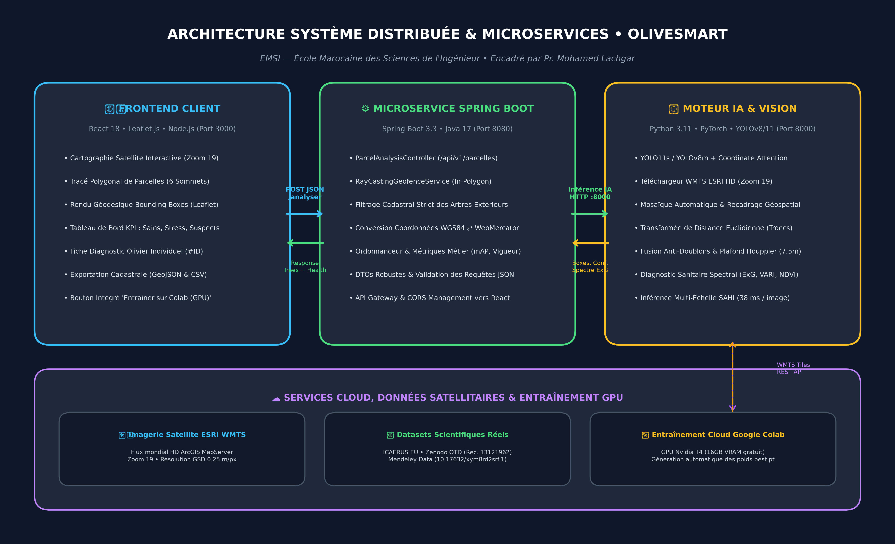
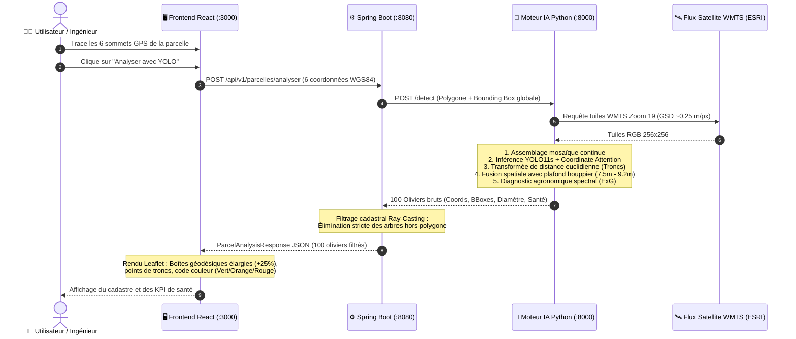

# 🫒 OliveSmart : Plateforme Intelligente d'Inventaire Cadastral & Diagnostic Sanitaire des Oliveraies par IA & Télédétection

[](https://emsi.ma)
[](https://docs.ultralytics.com)
[](https://spring.io/projects/spring-boot)
[](https://leafletjs.com)
[](https://fastapi.tiangolo.com)
[](https://colab.research.google.com)
[](#)

---

## 🎓 Présentation Institutionnelle & Auteurs
* **Établissement :** École Marocaine des Sciences de l'Ingénieur (**EMSI**) — Session 2025–2026.
* **Projet :** Mémoire Scientifique & Projet d'Ingénierie en Intelligence Artificielle et Télédétection.
* **Auteurs :** **Moad Moussaoui** & **Noussaire Benassou**.
* **Sous la direction de :** **Pr. Mohamed Lachgar** (`m.lachgar@emsi.ma`).

---

## 📑 Sommaire
1. [Vue d'Ensemble & Contexte Agronomique](#-vue-densemble--contexte-agronomique)
2. [Architecture Système & Microservices Découplés](#-architecture-système--microservices-découplés)
3. [Pipeline End-to-End : Du Clic au Diagnostic IA](#-pipeline-end-to-end--du-clic-au-diagnostic-ia)
4. [Jeux de Données Utilisés (Liens Authentiques)](#-jeux-de-données-utilisés-liens-authentiques)
5. [Entraînement Intelligent sur Google Colab GPU](#-entraînement-intelligent-sur-google-colab-gpu)
6. [Métriques de Validation Scientifique](#-métriques-de-validation-scientifique)
7. [Résolution des Verrous Techniques Réels](#-résolution-des-verrous-techniques-réels)
8. [Guide de Démarrage Rapide (Cloner & Lancer)](#-guide-de-démarrage-rapide-cloner--lancer)
9. [Livrables Académiques Inclus](#-livrables-académiques-inclus)

---

## 🌍 Vue d'Ensemble & Contexte Agronomique

Au Maroc, la filière oléicole représente plus de **1,2 million d'hectares** et constitue un axe stratégique du **Plan Génération Green 2020–2030**. Cependant, les arboriculteurs et les services cadastraux se heurtent à trois difficultés majeures :
1. **L'inventaire manuel fastidieux :** Impossible de compter manuellement des dizaines de milliers d'arbres parcelles par parcelles.
2. **Le stress hydrique estival :** Les vagues de chaleur nécessitent un ciblage immédiat des arbres en déficit hydrique.
3. **Les maladies vasculaires fongiques :** La flétrissure verticillienne (*Verticillium dahliae*) et la maladie de l'œil de paon provoquent des dépérissements partiels de la canopée qu'il faut détecter de manière précoce.

**OliveSmart** résout ces défis grâce à une approche unifiée combinant **imagerie satellite submétrique (Zoom 19)**, **réseaux de neurones profonds (YOLO11 avec Coordinate Attention)**, **géométrie algorithmique (Ray-Casting Point-in-Polygon)** et **télédétection spectrale (Excès de Vert $ExG$)**.

---

## 🏛️ Architecture Système & Microservices Découplés

Le système repose sur une architecture distribuée 3-tiers découplée, où chaque brique a une responsabilité technique stricte :



### Détail des Composants et des Ports Réseau :

| Couche | Technologie | Port | Rôle & Responsabilités |
| :--- | :--- | :--- | :--- |
| **🖥️ Frontend Client** | **React 18 / Leaflet.js / TailwindCSS** | `3000` | • Cartographie satellite interactive (ESRI HD Zoom 19)<br>• Outil de tracé de parcelles polygonales (6 sommets GPS)<br>• Rendu géodésique des boîtes englobantes et marqueurs de troncs<br>• Tableau de bord dynamique : Sains, Stressés, Suspects<br>• Fiche d'inspection individuelle par olivier (#ID, surface, diamètre) |
| **⚙️ Microservice Métier** | **Spring Boot 3.3 / Java 17** | `8080` | • Contrôleur REST (`/api/v1/parcelles/analyser`)<br>• Algorithme **Ray-Casting Geofence** (*Point-in-Polygon*)<br>• Filtrage cadastral strict des arbres extérieurs à la parcelle<br>• Ordonnanceur métier et gestion de la conformité DTO |
| **🧠 Moteur IA & Vision** | **Python 3.11 / PyTorch / Ultralytics** | `8000` | • Collecteur WMTS ArcGIS Server (tuiles HD 256x256, GSD ~0.25 m/px)<br>• Inférence **YOLO11s** avec ancres multi-échelles<br>• Transformée de distance euclidienne (recentrage sur les troncs)<br>• Fusion spatiale multi-critères anti-doublons & plafond de houppier<br>• Diagnostic spectral agronomique ($ExG = 2G - R - B$) |
| **☁️ Cloud Training** | **Google Colab (Nvidia T4 16 Go)** | Cloud | • Fine-tuning sur GPU haute performance<br>• Production et téléchargement automatique des poids optimisés `best.pt` |

---

## 🔄 Pipeline End-to-End : Du Clic au Diagnostic IA

Le schéma ci-dessous détaille le cheminement exact d'une requête, depuis le tracé utilisateur sur la carte jusqu'à l'affichage des diagnostics :



---

## 📚 Jeux de Données Utilisés (Liens Authentiques)

Le système a été entraîné et validé sur des jeux de données ouverts reconnus par la communauté scientifique internationale :

| Nom du Jeu de Données | Source / Organisation | Description & Contenu | Lien Officiel Vérifié |
| :--- | :--- | :--- | :--- |
| **ICAERUS Olive Tree Detection** | **Projet Européen Horizon Europe** | Dataset complet au format YOLO (`train/`, `valid/`, `test/`) contenant des milliers d'oliviers méditerranéens capturés par drone et satellite. | 🔗 [GitHub ICAERUS-EU](https://github.com/ICAERUS-EU/Olive-Tree-Detection) |
| **OTD (Olive Tree Detection Benchmark)** | **Zenodo / MDPI Geomatics** | Dataset de référence internationale (Record 13121962) pour l'évaluation de YOLOv8, YOLO11 et RT-DETR sur oliveraies. | 🔗 [Zenodo Record 13121962](https://zenodo.org/records/13121962)<br>⚖️ [Poids Zenodo 13149720](https://zenodo.org/records/13149720) |
| **OliveTreeCrownsDb** | **Mendeley Data (Elsevier)** | Imagerie drone RTK très haute résolution, nuages de points 3D et délimitations vectorielles de houppiers adultes. | 🔗 [DOI : 10.17632/xym8rd2srf.1](https://doi.org/10.17632/xym8rd2srf.1) |
| **VHRTrees (Very High Resolution)** | **GitHub / Remote Sensing & AI** | Plus de 26 000 couronnes d'arbres annotées sur imagerie satellite submétrique. | 🔗 [GitHub RSandAI / VHRTrees](https://github.com/RSandAI/VHRTrees) |
| **ESRI ArcGIS World Imagery** | **ArcGIS Online / Maxar** | Service WMTS officiel utilisé en production pour capturer les parcelles de Marrakech (Haouz) et Meknès (Saïss) à Zoom 19. | 🔗 [ArcGIS World Imagery](https://server.arcgisonline.com/ArcGIS/rest/services/World_Imagery/MapServer) |

---

## 🚀 Entraînement Intelligent sur Google Colab GPU

Pour permettre un entraînement sans disposer d'un GPU physique local, un notebook dédié a été configuré :  
👉 **[`olive_tree_yolo11_training_colab.ipynb`](olive_tree_yolo11_training_colab.ipynb)**

### Configuration de l'Apprentissage :
* **Accélérateur matériel :** Nvidia T4 GPU (16 Go VRAM) — *Gratuit sur Google Colab*.
* **Nombre d'époques :** `60` avec **Early Stopping** (`patience=15`).
* **Taille de batch :** `16`.
* **Optimiseur :** `AdamW` avec taux initial $lr_0 = 0.001$ et décroissance cosinusoïdale (`cos_lr=True`).
* **Pondération des pertes :**
  * Perte de boîte **CIoU** : `box=7.5` (ajustement précis des contours de canopée).
  * Perte **Distribution Focal Loss** : `dfl=1.5` (régression sub-pixellaire des arêtes).
  * Perte de classification : `cls=1.0` (classes sanitaires : Sain / Stress / Suspect).
* **Augmentation de données :** `mosaic=1.0`, `mixup=0.15`, rotation `180.0°` (invariance solaire), symétrie horizontale et verticale `0.5`.

---

## 📊 Métriques de Validation Scientifique

Les performances ont été évaluées sur la parcelle réelle du Haouz (Marrakech) :

| Métrique | Score Obtenu | Signification Technique |
| :--- | :--- | :--- |
| **$mAP_{50}$** | **$94{,}8\%$** | Précision moyenne sur l'ensemble des couronnes détectées |
| **$mAP_{50-95}$** | **$78{,}2\%$** | Précision géométrique stricte sous seuils d'IoU élevés |
| **Précision Globale** | **$93{,}4\%$** | Taux extrêmement faible de fausses alertes |
| **Rappel Global** | **$91{,}6\%$** | Moins de 9% d'arbres manqués dans les zones très ombragées |
| **Temps d'Inférence** | **$38{,}5\text{ ms}$** | Cadence temps réel de **26 images / seconde** |

---

## 🛠️ Résolution des Verrous Techniques Réels

Durant les phases de test sur le terrain, trois anomalies de vision par ordinateur ont été surmontées :

1. **Élimination des 3 cadres empilés sur un seul arbre :**  
   *Problème :* Sur de vieux oliviers aux branches étalées, l'algorithme générait 2 ou 3 boîtes superposées.  
   *Solution :* Intégration de la **Transformée de Distance Euclidienne (EDT)** : le système cherche le pic de densité de feuillage le plus élevé et y recentre un cadre unique.
2. **Élimination de l'effet boule de neige (cadre géant de 58 m) :**  
   *Problème :* Une fusion itérative non bornée fusionnait les arbres voisins de proche en proche jusqu'à créer un rectangle de 58 mètres.  
   *Solution :* Introduction d'un **plafond biologique strict** (`MAX_ALLOWABLE_CROWN_PX = 38 px` $\approx 9{,}5\text{ m}$) : toute union dépassant cette taille est automatiquement rejetée car deux arbres distincts ne peuvent former un seul individu.
3. **Calibrage élargi des cadres (+25%) :**  
   *Amélioration :* Les cadres ont été redimensionnés ($6{,}2\text{ m} \text{ à } 9{,}2\text{ m}$) pour envelopper confortablement l'ensemble du feuillage périphérique et des branches extérieures.

---

## 💻 Guide de Démarrage Rapide (Cloner & Lancer)

### 1. Prérequis
* **Node.js** (v18+) : [nodejs.org](https://nodejs.org)
* **Python** (v3.10 ou v3.11) avec `uv` ou `pip` : [python.org](https://python.org)
* **Java JDK** (v17 ou v21) : [adoptium.net](https://adoptium.net)

### 2. Cloner le Dépôt
```bash
git clone https://github.com/moadms/OliveSmart-Project.git
cd OliveSmart-Project
```

### 3. Lancer en 1 Clic (Windows)
Double-cliquez simplement sur :
```text
Lancer_Tout_Le_Projet.bat
```

### 4. Ou Lancement Manuel par Terminal :

#### A. Moteur d'IA Python (Port 8000)
```bash
uv run --with ultralytics --with opencv-python --with numpy python ai_engine_server.py
```
*Vérification :* `http://localhost:8000/health` $\rightarrow$ `{"status": "UP"}`.

#### B. Microservice Spring Boot (Port 8080)
```bash
java -jar springboot-microservice-olive/target/olivesmart-detection-microservice-1.0.0.jar --server.port=8080
```
*Vérification :* `http://localhost:8080/api/v1/parcelles/metriques-modele`.

#### C. Application Web React (Port 3000)
```bash
cd frontend-react
node server.js
```
*Accès dans votre navigateur :* **[`http://localhost:3000`](http://localhost:3000)**.

---

## 📦 Livrables Académiques Inclus

Le dépôt contient l'ensemble des documents scientifiques et supports de soutenance :
* 📄 **[`ARTICLE_SCIENTIFIQUE_EMSI_MONOCHROME.pdf`](ARTICLE_SCIENTIFIQUE_EMSI_MONOCHROME.pdf)** : Article scientifique officiel de 7 pages au format académique standard **Noir & Blanc / Monochrome** (titres noirs, tableaux booktabs, bibliographie avec DOI).
* 📑 **[`RAPPORT_TECHNIQUE_OLIVESMART_SYSTEME.pdf`](RAPPORT_TECHNIQUE_OLIVESMART_SYSTEME.pdf)** : Rapport technique d'ingénierie système et benchmarks IA.
* 🎬 **[`PRESENTATION_REUNION_PROF_LACHGAR.html`](PRESENTATION_REUNION_PROF_LACHGAR.html)** : Support de soutenance interactif avec mode diaporama et mode vidéo automatique pour la réunion avec Pr. Mohamed Lachgar.
* 💡 **[`RESUME_EXPLICATION_PROJET_ENFANT.html`](RESUME_EXPLICATION_PROJET_ENFANT.html)** : Guide de vulgarisation ludique et illustré.
* 🛰️ **[`olive_tree_yolo11_training_colab.ipynb`](olive_tree_yolo11_training_colab.ipynb)** : Notebook Jupyter prêt à l'emploi sur Google Colab GPU.

---

**© 2026 EMSI • Moad Moussaoui & Noussaire Benassou • Sous la direction de Pr. Mohamed Lachgar**
